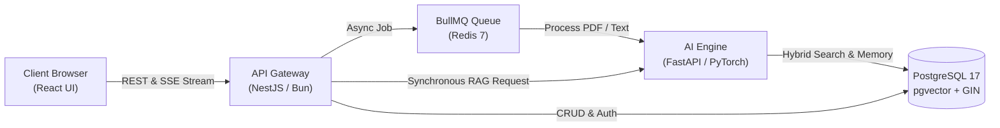
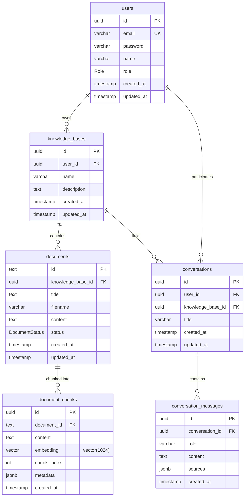
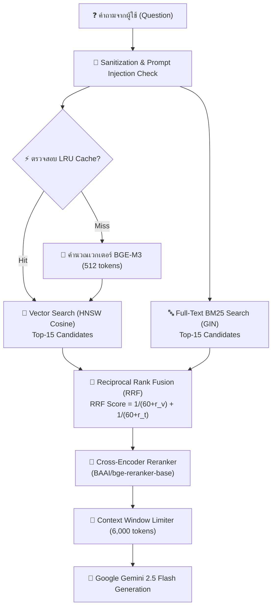
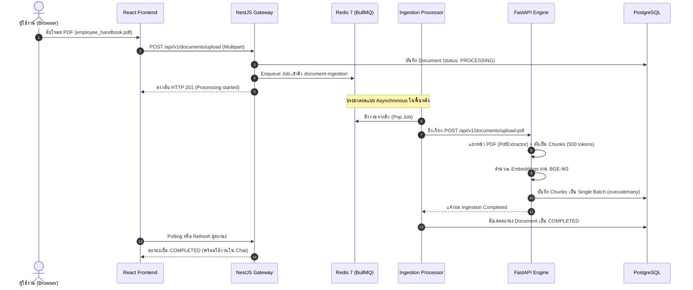

# 🏛️ KnowledgeAI System Architecture Deep Dive

เอกสารฉบับนี้อธิบายโครงสร้างสถาปัตยกรรมภายใน การออกแบบฐานข้อมูล และการทำงานร่วมกันระหว่าง Microservices ของระบบ **KnowledgeAI Enterprise**

---

## 🏗️ โครงสร้างระดับภาพรวม (High-Level Architecture)

ระบบออกแบบตามหลักการ **Decoupled Microservices Architecture** เพื่อแยกส่วนงานที่มีลักษณะต่างกันอย่างชัดเจน:
- **I/O-bound Service (NestJS)**: รับ-ส่งข้อมูล, จัดการสิทธิ์การเข้าถึง, ตรวจสอบความถูกต้อง (Validation), และบริหารจัดการคิว
- **CPU/GPU-bound Service (FastAPI + PyTorch)**: คำนวณเวกเตอร์คณิตศาสตร์ (Embeddings), ตัดคำ (Tokenization), และจัดลำดับความเกี่ยวข้อง (Cross-Encoder Reranking)
- **High-Performance Storage (PostgreSQL 17 + pgvector)**: ค้นหาความคล้ายคลึงของเวกเตอร์ (Cosine Distance) ควบคู่กับ Full-Text Indexing
- **Message Broker (Redis 7)**: จัดการคิวย่อยเอกสาร (BullMQ) เพื่อให้ Server รองรับการอัปโหลดพร้อมกันได้สูงโดยไม่เกิด CPU Spike



---

## 🗄️ โครงสร้างฐานข้อมูล (Entity-Relationship Diagram)



### การตั้งค่า Index สำคัญบน PostgreSQL
1. **`document_chunks.embedding`**:
   - ชนิด: `HNSW (vector_cosine_ops)`
   - จุดประสงค์: ค้นหา Approximate Nearest Neighbors (ANN) ด้วยความเร็วสูงระดับ sub-millisecond
2. **`document_chunks.content`**:
   - ชนิด: `GIN (to_tsvector('simple', content))`
   - จุดประสงค์: ค้นหาคำแบบ Full-Text Search (BM25) รองรับตัวเลข, รหัสเฉพาะ, และภาษาไทย
3. **`documents(knowledge_base_id, status)`**:
   - ชนิด: `Composite B-Tree`
   - จุดประสงค์: ป้องกัน Sequential Scan ในคำสั่ง JOIN ระหว่างค้นหาเวกเตอร์
4. **`conversation_messages(conversation_id, created_at)`**:
   - ชนิด: `Composite B-Tree`
   - จุดประสงค์: ดึงประวัติบทสนทนาย้อนหลังตามลำดับเวลาได้อย่างรวดเร็ว

---

## 🔍 กระบวนการ Hybrid Search & RRF Pipeline

เมื่อมีคำถามเข้ามาในระบบ ขั้นตอนการสืบค้นจะดำเนินไปตามแผนภาพดังนี้:



---

## 📬 วงจรการทำงานของ Background Ingestion (BullMQ + Redis)



---

## ⏱️ การวัดผลและ Observability

ในทุกคำตอบที่ AI ส่งกลับมา ระบบจะแนบข้อมูล Metadata การใช้ทรัพยากรและเวลาในการประมวลผล เพื่อให้สามารถติดตามและปรับแต่งประสิทธิภาพได้:

```json
{
  "timings": {
    "retrieval_ms": 2.66,
    "reranking_ms": 400.74,
    "generation_ms": 140.65,
    "total_ms": 555.70
  },
  "estimated_prompt_tokens": 278,
  "estimated_answer_tokens": 154,
  "retrieval_count": 2,
  "used_context_count": 2
}
```
